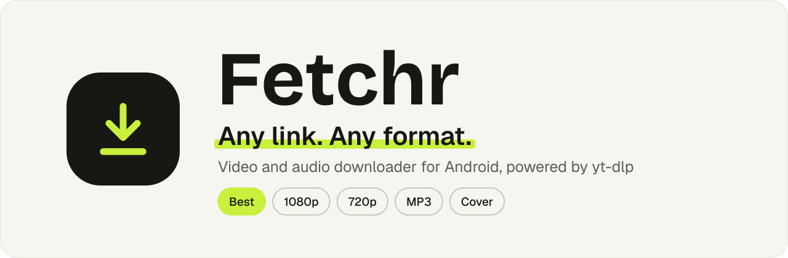
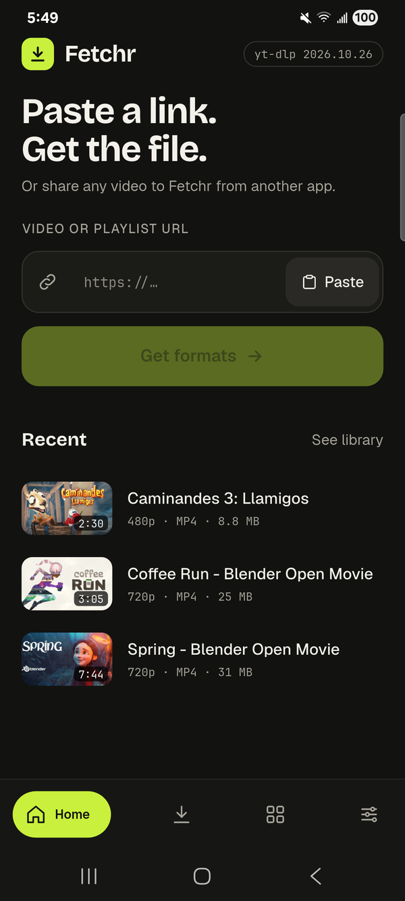
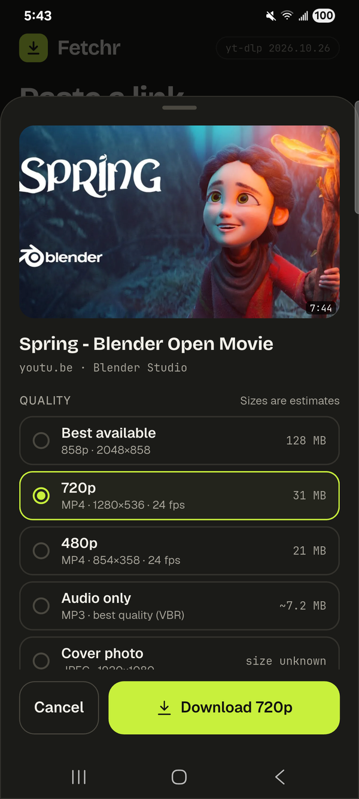
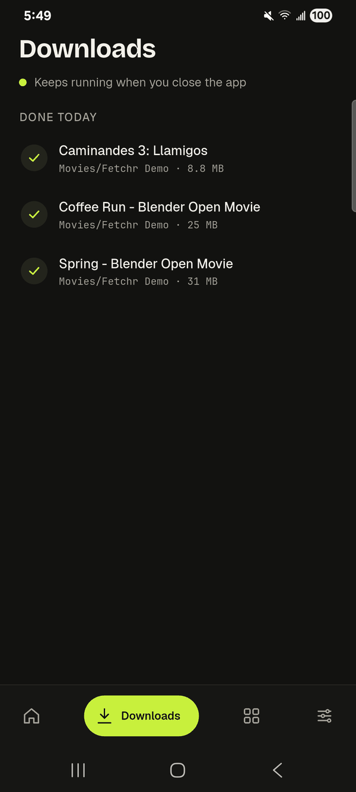
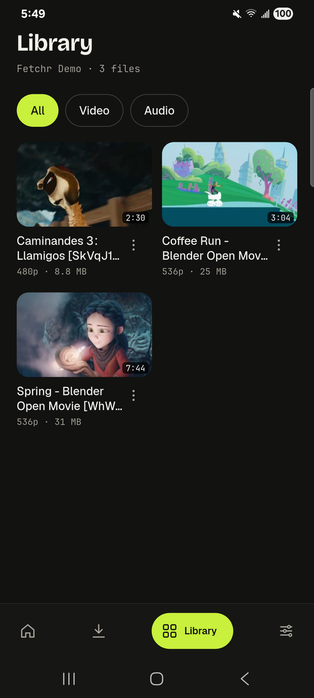
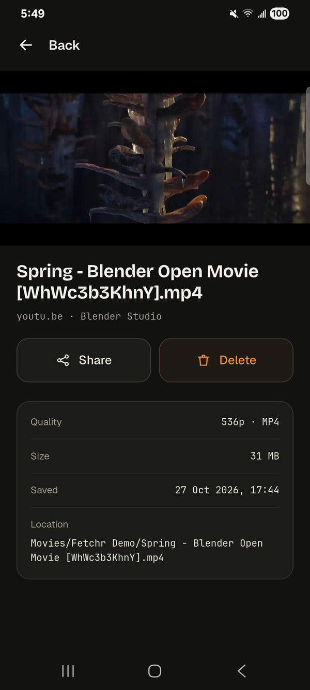
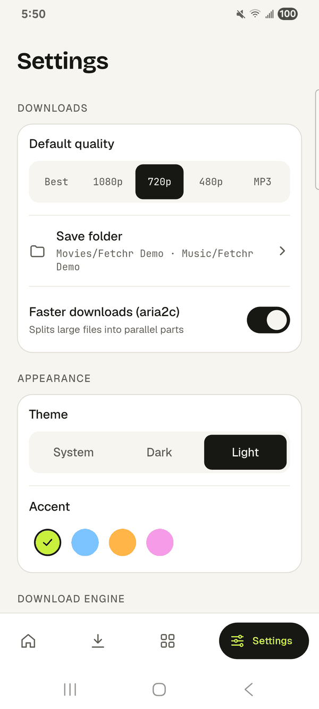

<!-- markdownlint-disable MD033 MD041 -->
<p align="center">
  <picture>
    <source media="(prefers-color-scheme: dark)" srcset="docs/images/banner-dark.svg">
    
  </picture>
</p>

<p align="center">
  <a href="https://github.com/defoibrahim/fetchr-app/releases/latest"></a>
  <a href="https://github.com/defoibrahim/fetchr-app/releases"></a>
  
  <a href="LICENSE"></a>
</p>

<p align="center">
  <b>Fetchr</b> is a free, open-source Android app that saves videos and audio from links, straight to your phone.<br>
  It's built on <a href="https://github.com/yt-dlp/yt-dlp">yt-dlp</a>, the open-source downloader behind most video tools, so it works with well over a thousand sites.<br>
  Paste or share a link, pick a quality, done. No account, no ads.
</p>

<p align="center">
  <a href="https://github.com/defoibrahim/fetchr-app/releases/latest"><b>Download the latest APK</b></a>
  &nbsp;·&nbsp; <a href="#features">Features</a>
  &nbsp;·&nbsp; <a href="#install">Install</a>
  &nbsp;·&nbsp; <a href="#privacy">Privacy</a>
  &nbsp;·&nbsp; <a href="#build-from-source">Build</a>
</p>

<p align="center">
  
  
  
</p>
<p align="center">
  
  
  
</p>

## Features

- **Any link.** Paste a link, let Fetchr pick it up from your clipboard, or share a link to Fetchr from your browser or any other app. Public videos from the sites [yt-dlp supports](https://github.com/yt-dlp/yt-dlp/blob/master/supportedsites.md) work; private, members-only and DRM-protected videos don't.
- **Any format.** The format sheet shows the title, thumbnail and the qualities the video offers: Best, 1080p, 720p or 480p video, MP3 audio, or the cover image, with an estimated size where the site reports one.
- **Playlists.** Open a playlist, tick the items you want and download them all in one quality.
- **Video to MP3.** Pick any video on your phone, from the gallery or the Files app, and Fetchr turns it into an MP3, with the same progress and notifications as a download. No permission needed.
- **Downloads that keep going.** Two at a time, with speed, size and time left, plus pause, resume, cancel and retry. They keep running when you leave the app, and a notification tells you when each one is done.
- **Your files, where you expect them.** Videos go to `Movies/Fetchr`, audio to `Music/Fetchr` and covers to `Pictures/Fetchr`, so your gallery and music apps see them. You can rename the folder; the Library shows the current one.
- **Library and player.** Browse what you saved, play it in the built-in player, share it, open its folder or delete it, with undo.
- **Always up to date.** When the app starts, it checks for a new yt-dlp at most once a day (you can turn that off), and Settings has an Update button for when a site changes.
- **Faster downloads.** Optionally splits large files into parts that download at the same time. Sites that throttle parallel connections always use yt-dlp's own downloader.
- **Looks the part.** Light, dark or system theme, a choice of accent colours, and an animated launch.

## Install

1. On your phone, open the [latest release](https://github.com/defoibrahim/fetchr-app/releases/latest) and scroll to **Assets**.
2. Download the APK for your phone:
   - The file ending in `arm64-v8a-release.apk` fits nearly every phone from the last several years. Try it first.
   - The file ending in `armeabi-v7a-release.apk` is for older or budget phones running 32-bit Android. Use it if the first one says "App not installed".
3. Open the file. When Android asks, allow your browser or file manager to install apps, go back and tap **Install**. If Play Protect warns about an unknown app, tap **More details**, then **Install anyway**.

Fetchr needs Android 8.0 or later. To update, install the new APK over the old one; your settings and history stay. [Obtainium](https://github.com/ImranR98/Obtainium) can watch `https://github.com/defoibrahim/fetchr-app` and tell you about new versions.

In Brazil, Indonesia, Singapore and Thailand, certified Android phones now only install apps from [verified developers](https://support.google.com/android-developer-console/answer/16561738) without extra steps. There, installing Fetchr takes Android's advanced flow in Developer options, or `adb install` from a computer.

### Check your download (optional)

Every release is signed with the same key, which is how Android knows an update comes from this project. Releases are built and signed by GitHub Actions from this repository ([release workflow](.github/workflows/release.yml)). To check an APK before installing it, run this on a computer with the Android SDK build-tools:

```bash
apksigner verify --print-certs Fetchr-*-arm64-v8a-release.apk
```

The certificate's SHA-256 digest must be:

```text
d7358fdf6452918085293a708db117d6a89ba6e929914642e79343d7526fa199
```

### Permissions

| Permission | Why |
| --- | --- |
| Internet and network state | To read links, download files and tell when you're offline. |
| Notifications | Download progress and the "Downloaded" or "Download failed" message. Optional. |
| Foreground service and wake lock | Keeps downloads going when you leave the app or the screen turns off. |
| Storage (Android 8 and 9) | Required to save downloads. |
| Videos and audio (Android 13+), storage (Android 10 to 12) | Optional. Lets the Library show files from an earlier install; new downloads don't need it. |

## Privacy

Fetchr has no account, no ads and no analytics SDK, and your downloaded files never leave your phone. Besides the sites you download from (and their image servers, for thumbnails), the app contacts:

- **Google's connectivity check**, before each link lookup and yt-dlp update, to tell "offline" from "site down".
- **GitHub**, to download yt-dlp updates.
- **[Sentry](https://sentry.io)**, for crash and error reports.

A Sentry report holds the error and where it happened, the app's recent log messages, your phone model, Android version and app version, and a random ID for this install. The log messages have tokens removed but can include the link of a lookup that failed. Sentry also records when the app starts and stops, without any content. When a session hits an error, it keeps a short replay of the screen with text and images masked; the video player area may still show a frame. There is no switch to turn crash reporting off yet.

## Build from source

You need the Android SDK with platform 37, JDK 17 and Flutter 3.47.7. [fvm](https://fvm.app) installs that Flutter for you and is what the project's scripts use. The first build downloads libmpv and youtubedl-android, so it needs a network connection.

### Debug build (for development only)

A quick build to try changes on your own phone. It is slower and larger than a release build, so don't use it to judge performance:

```bash
fvm install
fvm flutter pub get
fvm flutter build apk --debug --split-per-abi --target-platform android-arm64
```

The APK lands in `build/app/outputs/flutter-apk/`. Always pass `--split-per-abi --target-platform`: a universal APK carries Python, FFmpeg and aria2c for every CPU type and weighs over 200 MB.

### Release build (what the published APKs are)

The APKs on the [releases page](https://github.com/defoibrahim/fetchr-app/releases) are release builds: Dart compiled ahead of time to native ARM code and signed by GitHub Actions. To make one yourself, create a keystore and `android/key.properties` (gitignored) with `storeFile`, `storePassword`, `keyAlias` and `keyPassword`, then run:

```bash
fvm flutter build apk --release --split-per-abi --target-platform android-arm,android-arm64
```

Gradle also writes the APKs as `Fetchr-<version>-<commit>-<abi>-release.apk` in `build/app/outputs/apk/release/`; those are the files each release attaches.

### Contributing

```bash
git config core.hooksPath tool/hooks              # format and architecture checks on every commit
bash tool/check.sh full                           # gates, format, codegen, analyze, tests
(cd android && ./gradlew :app:testDebugUnitTest)  # Kotlin tests; on Windows use gradlew.bat
```

Run one Flutter build first, so that `android/gradlew` exists. After adding assets, run `fvm dart run build_runner build`.

## How it works

Fetchr is a Flutter app with its download engine in Kotlin. The Flutter side uses Riverpod and go_router on a Clean Architecture split into `data`, `domain` and `presentation` layers, with architecture gates in `tool/check.sh`. The Kotlin side runs yt-dlp, FFmpeg and aria2c through [youtubedl-android](https://github.com/JunkFood02/youtubedl-android) in a foreground service and saves through MediaStore. The two talk over a typed [pigeon](https://pub.dev/packages/pigeon) contract. [AGENTS.md](AGENTS.md) covers the architecture, the rules and how to extend the app.

## Credits

Fetchr stands on [yt-dlp](https://github.com/yt-dlp/yt-dlp), [youtubedl-android](https://github.com/JunkFood02/youtubedl-android), [FFmpeg](https://ffmpeg.org), [aria2](https://aria2.github.io) and [media_kit](https://github.com/media-kit/media-kit) (libmpv), each under its own license. It uses the [Bricolage Grotesque](https://github.com/ateliertriay/bricolage), [Geist](https://github.com/vercel/geist-font) and [JetBrains Mono](https://github.com/JetBrains/JetBrainsMono) fonts under the SIL Open Font License.

The screenshots show *Spring*, *Coffee Run* and *Caminandes 3: Llamigos* by [Blender Studio](https://studio.blender.org), released under Creative Commons Attribution.

## Disclaimer

Fetchr is an independent, open-source front end for yt-dlp. It is not affiliated with, endorsed by or sponsored by YouTube, Google or any site it can download from, and all trademarks belong to their owners. It hosts no content and does not get around DRM. You are responsible for what you download: save only content you own or have permission to keep, and respect each site's terms and the rights of the people who made it. Fetchr is provided as is, without warranty.

## License

Copyright (C) 2026 defoibrahim

Fetchr is free software: you can redistribute it and modify it under the terms of the [GNU General Public License v3.0](LICENSE).
